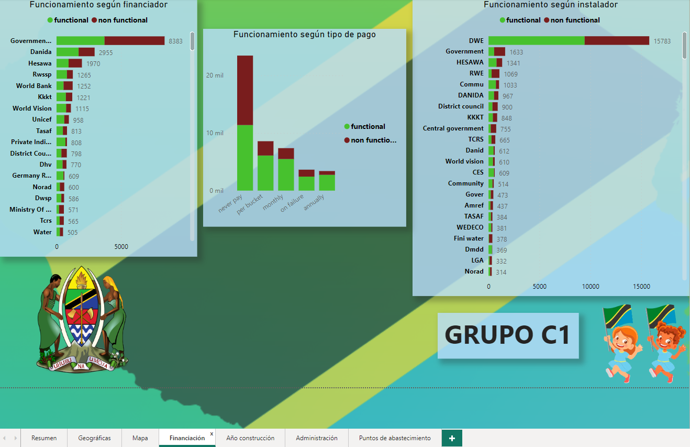
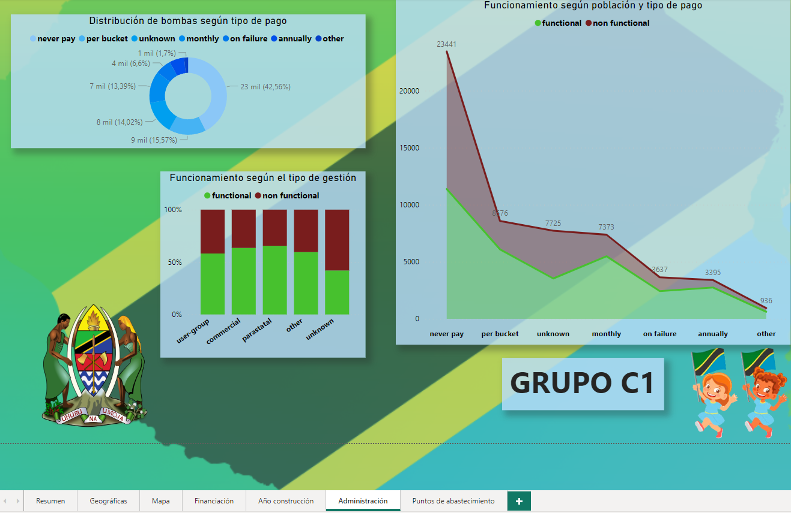
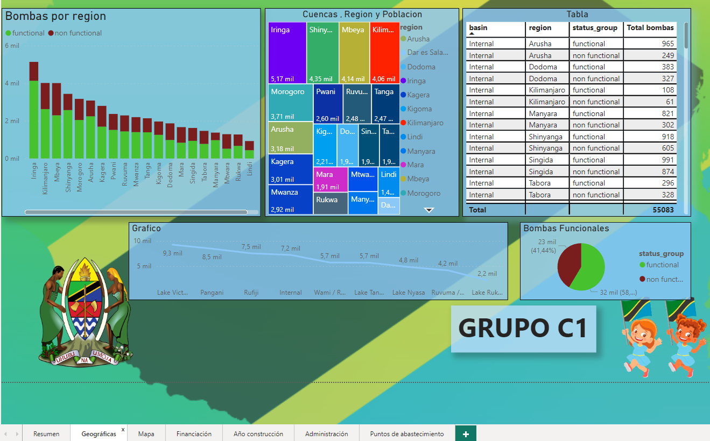
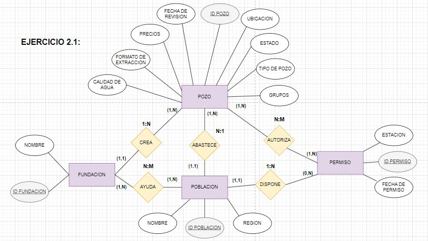

# Análisis del abastecimiento de agua en Tanzania

Proyecto de análisis de datos y machine learning para **predecir si una bomba de agua de Tanzania funciona o no**, a partir de sus características (financiador, cuenca, tipo de extracción, calidad y cantidad de agua, ubicación, etc.).

Se hizo como reto grupal del bootcamp **Python Data Analyst de NTT DATA** y recorre el ciclo completo: carga y limpieza de datos con **pandas**, análisis exploratorio, modelo de datos en **SQL (MySQL)**, **modelos de clasificación** con scikit-learn y XGBoost, mapa interactivo con **Folium** y cuadros de mando en **Power BI**.

**[Ver el mapa interactivo de las bombas](https://denitsa-mutlova.github.io/analisis-agua-tanzania/mapa_bombas.html)** (muestra de 4.000 bombas: verde = funcional, rojo = no funcional)


---

## El problema

El dataset (55.083 bombas × 26 columnas) describe puntos de agua de Tanzania y su estado (`status_group`). Para este proyecto se trató como un problema de **clasificación binaria**: *funcional* frente a *no funcional*. Saber qué bombas tienen más probabilidad de fallar permite priorizar las revisiones y el mantenimiento.

## Qué se hizo

| Fase | Contenido | Dónde |
|---|---|---|
| **1. Carga y limpieza** | Carga del CSV, tipos de datos, nulos, duplicados, columnas sin valor (`id`, `num_private`, `recorded_by`, `wpt_name`), agrupación de categorías, imputación | `notebooks/01_analisis_variables.ipynb` |
| **2. Análisis exploratorio** | Distribución de la variable objetivo y relación de cada variable con ella (gráficos, χ², correlación de Pearson, `SelectKBest`), outliers | `notebooks/01_analisis_variables.ipynb` |
| **3. Modelo de datos (SQL)** | Diseño del modelo entidad-relación y creación de tablas, inserción de datos y consultas en MySQL | `sql/`, `docs/diagrama_er.png` |
| **4. Modelos de machine learning** | Regresión logística, árbol de decisión, Random Forest y XGBoost; comparación de métricas con distintos conjuntos de variables y con/sin outliers | `notebooks/02_modelos.ipynb` |
| **5. Visualización** | Mapa interactivo de bombas (Folium) y cuadros de mando en Power BI | `src/generar_mapa.py`, `docs/` |

## Resultados

Métricas sobre el 20 % de datos reservado para test (clase positiva: *funcional*), con el conjunto de variables seleccionado:

| Modelo | Precisión | Recall | F1 | Exactitud |
|---|---|---|---|---|
| Regresión logística | 0,673 | 0,835 | 0,745 | 0,664 |
| Árbol de decisión | 0,834 | 0,833 | 0,833 | 0,804 |
| **Random Forest** | **0,852** | 0,889 | **0,870** | **0,844** |
| XGBoost | 0,846 | 0,885 | 0,865 | 0,838 |

Con el conjunto ampliado de variables (21 columnas) y tras tratar los outliers, el rendimiento sube un poco más:

| Variante | Precisión | Recall | F1 | Exactitud |
|---|---|---|---|---|
| Random Forest, 21 variables | 0,856 | 0,905 | 0,880 | 0,855 |
| XGBoost, 21 variables | 0,836 | 0,918 | 0,875 | 0,846 |
| XGBoost, 21 variables, sin outliers | 0,849 | 0,921 | 0,884 | 0,857 |

**Lectura:** los modelos basados en árboles superan con claridad a la regresión logística (la relación entre las variables y el estado de la bomba no es lineal). Random Forest da el mejor equilibrio general y XGBoost el mejor recall, que es lo que interesa si el objetivo es no pasar por alto bombas que fallan.

> Los resultados se fijan con semilla (`np.random.seed(42)`) y las versiones de `requirements.txt`; con otras versiones pueden variar ligeramente.

### Cuadros de mando (Power BI)

| Financiación | Administración |
|---|---|
|  |  |



### Modelo de datos (MySQL)



## Limitaciones y posibles mejoras

- Los escaladores se ajustan **antes** de separar entrenamiento y test, así que el test influye algo en el entrenamiento (*data leakage*). Lo correcto es ajustarlos solo con el entrenamiento, dentro de un `Pipeline`.
- La búsqueda de hiperparámetros con `GridSearchCV` (validación cruzada de 5 particiones) está en el cuaderno **comentada**, porque con los recursos disponibles tardaba demasiado. Solo la fila de XGBoost de la primera tabla usa los hiperparámetros que salieron de esa búsqueda; el resto de modelos y variantes usan los valores por defecto.
- XGBoost con parámetros por defecto rinde mejor en entrenamiento que en test (F1 0,90 frente a 0,86): hay algo de sobreajuste.
- Los outliers se tratan de forma sencilla (se eliminan los valores fuera de los bigotes del diagrama de cajas), sin profundizar más.

## Estructura del repositorio

```
analisis-agua-tanzania/
├── notebooks/
│   ├── 01_analisis_variables.ipynb   # limpieza y análisis exploratorio
│   └── 02_modelos.ipynb              # modelos de ML y comparación
├── sql/                              # esquema, datos y consultas (MySQL)
├── src/generar_mapa.py               # mapa interactivo (Folium)
├── data/
│   ├── muestra_reto_agua.csv         # muestra de 1.000 filas
│   └── README.md                     # cómo obtener el dataset completo
├── docs/                             # diagrama ER, capturas de Power BI, mapa
└── requirements.txt
```

## Cómo ejecutarlo

```bash
git clone https://github.com/Denitsa-Mutlova/analisis-agua-tanzania.git
cd analisis-agua-tanzania
python -m venv .venv
source .venv/bin/activate        # en Windows: .venv\Scripts\activate
pip install -r requirements.txt
jupyter notebook
```

El dataset completo lo facilitó el curso y no se incluye (ver [`data/README.md`](data/README.md)). Colócalo como `data/reto_agua.csv` para reproducir los resultados; con `data/muestra_reto_agua.csv` se puede probar el código con una muestra.

Para el SQL: ejecutar en orden los scripts de `sql/` en MySQL (`00` a `03`).

## Tecnologías

Python · pandas · NumPy · scikit-learn · XGBoost · matplotlib · seaborn · Folium · SciPy · MySQL · Power BI · Jupyter

## Licencia

[MIT](LICENSE)
